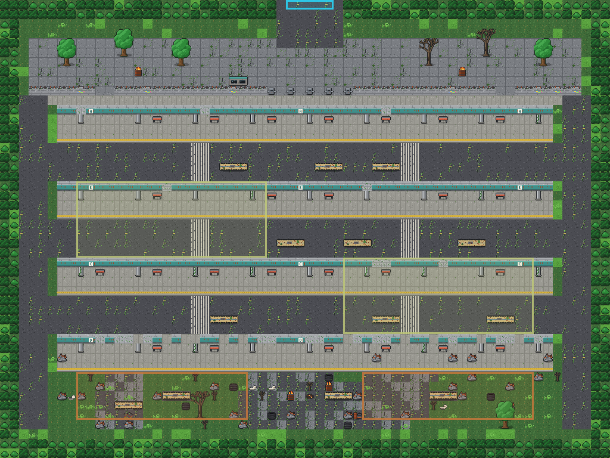
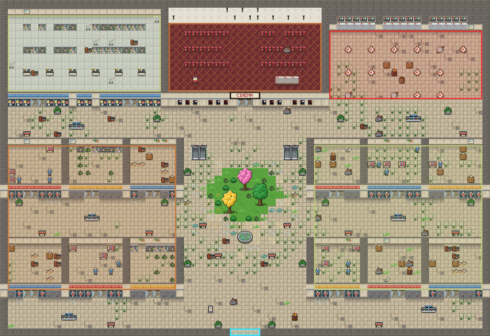

# MeuMMO

MMORPG de ação em 2D, inspirado no **folclore brasileiro**, que roda no navegador do computador e do celular.
Feito em dupla: ideias, design e testes de um lado, código do Claude do outro. O nome é provisório.

O mundo é **Pindorama — Selva de Pedra**: muito tempo depois do fim do mundo, a floresta tomou São Paulo e as
lendas voltaram. Tudo começa no **Refúgio de Guarapiranga**, uma vila flutuante no meio da represa.


## Onde estamos: M1 — Combate de ação ✅ · M2 — Progresso salvo ✅ · M3 — Mundo (começando)

- Entre com **nome e senha**: na primeira vez o personagem nasce na hora; depois ele volta com o nível,
  a XP, a vida, a mochila e o lugar onde parou
- Siga a avenida a leste até o fim e chegue nas **Ruínas de Santo Amaro** (níveis 4 a 8): quarteirões de prédios
  mortos e lojas fechadas. Nos prédios desabados vivem o **Corpo-Seco** e o **Capelobo**; no largo do chafariz seco,
  a chefe: a **Mula sem Cabeça**, que dá investidas em linha reta e deixa o chão pegando fogo
- De Santo Amaro, desça a rua do meio até o fim e chegue no **Terminal Santo Amaro**: as plataformas cobertas
  A, B, C e D continuam de pé, com a cobertura de concreto furada e cheia de cipó, e os ônibus enferrujados nunca
  mais saíram das pistas. Na entrada, as catracas e a bilheteria; no fundo, a parte que desabou virou mato e
  acampamento, com tambores de fogo (por enquanto quem anda por lá é o Corpo-Seco e o Capelobo)
- Ao lado do largo de Santo Amaro, entre pela porta de vidro do **Shopping do Largo Treze** (o letreiro perdeu o
  "I"): a claraboia do átrio caiu e a mata entrou — dois ipês e uma árvore cresceram no jardim do meio, o sol entra
  pelo buraco e a chuva enche o chafariz. Em volta, corredores escuros com lojas de porta de aço, vitrines quebradas
  com manequins, quiosques e escadas rolantes paradas; no norte, o supermercado (Corpo-Seco entre as gôndolas), o
  cinema (Capelobo entre as poltronas) e a praça de alimentação (onde o Saci apronta)
- Desça a trilha do brejo, ao sul, até a **Represa Billings**: um labirinto de canais de água verde e ilhas de
  mato ligadas por passarelas, com buritis, aguapés, casas afundadas, a usina velha, a ponte da rodovia quebrada
  no meio do lago e a prainha de frente para a pedra onde a **Iara**, a chefe, canta (quem fica perto é encantado e
  puxado para ela; a esquiva solta). Nos canais do oeste, o **Jacaré Mutante** (lento na terra, mas a abocanhada
  dói); no lago das casas afundadas, o **Boto Encantado**, que cospe jatos d'água de longe. Também moram lá
  Jararaca, Corpo-Seco e Capelobo
- Explore o Refúgio de Guarapiranga com outros jogadores, em tempo real, com chat: píeres, matas, brejo e uma avenida em ruínas
- Enfrente o **Sagui Travesso** (joga frutas), a **Jararaca** (dá o bote) e o **Saci** (gira e some num redemoinho)
- Os monstros **avisam** os golpes com quadrados vermelhos no chão: saia de lá ou use a esquiva
- Ganhe XP, suba de nível e volte para a vila quando desmaiar
- Monstros deixam **itens** para quem ajudou a derrubá-los: guarde na **Mochila**, equipe chapéus, estilingues,
  coletes e amuletos (mais vida, dano e defesa) e coma bananas para recuperar vida
- O que você equipa **aparece no seu personagem** para todo mundo ver (e no boneco da mochila)
- Funciona no computador (mouse e teclado) e no celular (toque e botões)

### Controles

| Ação | Computador | Celular |
|---|---|---|
| Andar | `W` `A` `S` `D` / setas, ou clique no chão (`C` liga e desliga o andar devagar) | joystick ou toque no chão |
| Estilingue | **segure e solte**: botão esquerdo em cima do monstro, botão direito (vai para o mouse) ou `J` (no monstro mais perto). Quanto mais segurar (até ~1 s), mais forte e mais longe | segure e solte o botão **Estilingue**; toque rápido no monstro = pedra fraca na hora |
| Bordunada (golpe em arco) | `Q` | botão **Bordunada** |
| Fôlego (cura) | `E` | botão **Fôlego** |
| Esquiva | `Shift` | botão **Esquiva** |
| Pular (por enquanto só de enfeite: quem está perto vê) | `Espaço` | — (o botão vem com o desenho do pulo) |
| Defesa (segura os golpes da frente e gasta energia) | segure `F` | segure o botão **Defesa** |
| Comida e remédio (atalhos) | `3` e `4` | os dois botões redondos |
| Afastar/aproximar a câmera | roda do mouse ou `−` e `+` | — |
| Conversar | `Enter` | toque na caixa de conversa |
| Mochila (itens e equipamentos) | `I` ou o botão **Mochila** · clique duplo num item equipa/usa · `Esc` fecha | botão **Mochila** |
| Mapa | `M` (ainda sendo feito: por enquanto só avisa) | — |
| Som (ligar/desligar e o volume da música, dos efeitos e do ambiente) | 🔊 no painel (sem tecla; dá para escolher uma) | 🔊 no painel |
| Trocar as teclas | 🔊 no painel → **Teclas**: clique na tecla e aperte a nova (fica guardado neste navegador) | — |

As teclas acima são o padrão: andar (`W` `A` `S` `D` e setas), `Enter`, `Esc`, `−` `+` e os números `1` a `4` são
fixos; as outras dá para trocar. No Windows, apertar o `Shift` 5 vezes seguidas abre o aviso das "Teclas de
Aderência": para desligar, Configurações → Acessibilidade → Teclado → Teclas de Aderência → desmarque o atalho.

Levar um golpe, esquivar ou levantar a defesa solta a pedra que você estava puxando. A defesa vira sozinha para o
monstro mais perto; a barra embaixo do pé é a energia dela (acabou, ela quebra: solte e espere voltar). O jogo
antigo (visto de cima, em `?antigo`) tem os controles de antes: clique para atirar e botão direito no chão para andar.

A visão do jogo está em [docs/DESIGN.md](docs/DESIGN.md) e o que vem depois em [docs/ROADMAP.md](docs/ROADMAP.md).

## Instalar no Windows (jeito fácil)

Abra o **PowerShell** (tecla Windows, digite `PowerShell`, Enter), cole esta linha e aperte Enter:

```powershell
irm https://raw.githubusercontent.com/bru1dasul-create/meummo/main/instalar-windows.ps1 | iex
```

Ele instala o que faltar (Node.js e Git), baixa o jogo em `E:\mmorpg`, instala as dependências
e cria dois atalhos na área de trabalho: **Jogar MeuMMO** e **Atualizar MeuMMO**.
Também oferece instalar o Tiled (editor de mapas). Pode rodar de novo quando quiser: ele só atualiza
e nunca apaga uma pasta que já tenha outras coisas.

## Como jogar no seu computador (qualquer sistema)

Precisa do [Node.js](https://nodejs.org) versão 22.13 ou mais nova. No terminal, dentro da pasta do projeto:

```bash
npm install
```

```bash
npm run dev
```

Abra **http://localhost:5173** (o jogo novo, em 2.5D; o jogo antigo, visto de cima, fica em
**http://localhost:5173/?antigo**). Para jogar com alguém na mesma rede Wi-Fi (inclusive pelo celular),
use o endereço que aparece como `Network` no terminal, por exemplo `http://192.168.0.10:5173`.

Quer ver o mundo cheio? Com o jogo rodando, abra outro terminal. Bots que passeiam pela vila:

```bash
npm run bots -- 10
```

Bots que caçam monstros:

```bash
npm run bots -- 6 --cacar
```

## Comandos

| Comando | O que faz |
|---|---|
| `npm run dev` | jogo + servidor em modo de desenvolvimento (recarregam sozinhos ao salvar) |
| `npm run check` | confere os tipos e roda todos os testes automáticos |
| `npm run build` e depois `npm start` | versão de produção: um único servidor na porta 3000 (reinicie o `npm start` depois de cada build) |
| `npm run bots -- 10` | 10 jogadores automáticos andando e conversando (`--cacar` para caçarem monstros); aparecem como "Bot ..." |
| `npm run gen:tiles` | redesenha a arte provisória (`public/assets/tiles.png`) |
| `npm run render:map` | desenha os mapas inteiros em `docs/mapa-<id>.png` |
| `npm run render:characters` | desenha personagens de exemplo, com animações e equipamentos, e os monstros pintados em `docs/personagens.png` |

## Personagens salvos

Cada personagem (nome + senha + progresso) fica no arquivo `saves/meummo.db`, dentro da pasta do jogo
(no seu PC, `E:\mmorpg\saves`). Esse arquivo **não vai para o GitHub** e o **Atualizar MeuMMO não mexe nele**.

- O jogo salva sozinho: ao sair, ao subir de nível, a cada 30 segundos e quando o servidor desliga.
- **Cópia de segurança:** com o jogo fechado, copie a pasta `saves` para outro lugar.
- **Começar do zero:** com o jogo fechado, apague a pasta `saves`.
- As senhas não ficam escritas no arquivo: ficam embaralhadas (scrypt), e nem quem abre o arquivo consegue lê-las.
  Ainda assim, por enquanto use uma senha só do jogo: na rede de casa ela viaja sem criptografia
  (isso muda quando o jogo for para a internet, no M5).

## Painel do administrador (ajustar o jogo sem mexer em arquivos)

Com o jogo ligado, abra **http://localhost:3000/admin** no navegador **do mesmo computador** onde o jogo está
rodando (o `jogar.bat` mostra esse endereço). Quem entra pela rede de casa não consegue abrir o painel.

- **Monstros:** vida, dano do golpe, tempo do aviso no chão, tempo entre golpes, XP, ouro, velocidade, se ataca
  sozinho, distância que percebe e persegue, tempo para renascer.
- **Itens:** preço na loja, cura (consumíveis) e o que os equipamentos somam (dano, vida, defesa). Nas armas com
  tiro próprio (o Arco de Bambu): tempo para carregar, alcance sem carga e com a carga cheia, tempo entre tiros e a
  velocidade da flecha.
- **Áreas de monstros:** cada área de cada mapa (nome, onde fica e o padrão do mapa): **qual monstro** nasce ali e
  **quantos** (0 a 50). Vale na hora: os monstros da área completam, somem ou trocam de tipo. O lugar da área é o do
  mapa (quem desenha os mapas muda no Tiled).
- **Missões:** nome, o que o personagem diz ao pedir e ao concluir, o objetivo que aparece na tela (vazio = o texto
  automático), **quantos** (e qual monstro ou item), nível mínimo, se dá para fazer de novo e a **recompensa** (XP,
  ouro e itens com quantidade). Vale na hora, até numa conversa aberta; quem já está fazendo a missão continua com o
  que já fez (se a quantidade baixar, já pode entregar). Quem dá a missão e a ordem delas ficam em `data/missoes.json`.
- **Combate:** a **pedra com carga** (tempo para carregar, dano e alcance com a carga cheia), a **defesa** (quanto do
  golpe segura, o ângulo que cobre, o tempo para subir, a energia que gasta e que volta, o tempo quebrada e a
  velocidade andando com ela) e quanto do **empurrão** a defesa segura. Vale na hora para quem está jogando; o
  empurrão de cada monstro fica na aba Monstros.
- **Loja e personagens:** o que cada um diz, **onde fica** (mapa, x e y — com vírgula no mapa novo, em metros), o que
  vende e quanto paga pelo que você vende. Mais fácil para mudar o lugar: no jogo, menu ADM → **Trazer para cá**
  (o personagem vem para onde você está e fica salvo; "voltar ao padrão" no painel devolve ao lugar dele).
- **Jogadores:** quem está online (mapa, posição, vida, ouro — atualiza sozinho) e, para cada um: **mudar o nível**
  (a XP do nível começa do zero e a vida enche), **dar XP** (sobe de nível como caçando), **dar ouro**,
  **dar item** (o que não couber na mochila fica no chão, ao lado), **curar**, **levar para** outro mapa ou posição
  (x e y vazios = ponto de nascimento) e **expulsar** (o progresso fica salvo e dá para entrar de novo). No topo,
  **aviso para todos** (aparece na tela de quem está jogando) e **trocar senha**, para quem esqueceu: escreva o nome
  do personagem e a senha nova (vale para qualquer personagem salvo, mesmo quem não está online) e passe a senha nova
  para a pessoa. Quem recebe vê no chat o que o administrador fez. Tudo fica registrado na janela do servidor (a
  senha nunca aparece lá). Banir fica para quando o jogo for para a internet (M5).
- **Administradores (menu ADM dentro do jogo):** na aba Jogadores, escreva o nome do seu personagem e clique em
  **Tornar administrador** (vale na hora, mesmo jogando, e até do celular: a senha dele protege). No jogo aparece o
  botão **ADM** (ou tecla **G**), com: **criar monstros** onde você está (até 10 por vez; eles não renascem),
  **derrubar os monstros perto** (você ganha a XP), **voar** (atravessa parede e árvore, rápido; ao pousar dentro de
  algo, vai para o chão livre), **invencível** (não leva dano e os monstros te ignoram), **teleporte ao clicar** (o
  clique no chão te leva até lá) e **curar**. Tudo fica registrado na janela do servidor.
- **Registros:** o que o servidor anota (quem entrou e saiu, o que o administrador fez, avisos e **erros**, inclusive
  os que acontecerem no navegador de quem joga, no PC ou no celular, com o aparelho e onde foi). Filtre por "erro" e
  use **Copiar tudo** para mandar a quem vai corrigir. Também ficam num arquivo por dia em `saves/registros/` (os
  últimos 14 dias). Um erro dentro do jogo agora fica anotado e não derruba mais o servidor.

Mudou, salvou: **vale na hora** para quem está jogando — até a vida dos monstros que já estão no mapa e a loja que
alguém está com aberta. Valor que não serve é recusado com o motivo (ex.: "vida precisa ser pelo menos 1").
Tempos são em milissegundos (1000 ms = 1 segundo).

Os ajustes ficam em `saves/ajustes.json`, **fora do GitHub**: atualizar o jogo não apaga nem dá conflito. Cada
número que você mudou aparece marcado, com o botão **voltar ao padrão**. Para um ajuste virar o padrão do projeto
(para todo mundo e para quem instalar do zero), abra a aba **Meus ajustes**, clique em **Copiar meus ajustes** e
mande para o chat "Estrutura e regras". Se uma atualização do jogo deixar algum ajuste sem sentido, o jogo liga
com os valores padrão, avisa no painel e guarda os ajustes antigos em `saves/ajustes-antigos.json`.

Os arquivos `data/*.json` continuam valendo como antes (são o padrão do projeto); o painel só põe os seus ajustes
por cima deles.

## Ajustar os monstros (sem programar)

Cada monstro fica em [`data/monsters.json`](data/monsters.json): `vida`, `dano` ([mínimo, máximo]),
`passoMs` (tempo para andar um quadrado — menor é mais rápido), `alcanceAgressao`, `xp`, `renascerMs`
e o `ataque` (`tipo`: `mordida`, `bote`, `giro`, `projetil` ou `investida`; `preparoMs` é o tempo do aviso vermelho;
`recuo` é quanto o golpe empurra quem leva, em centímetros — sem ele, vale o do tipo: 12 a 34).
Na `investida`, o monstro corre `alcance` tiles em linha reta atropelando quem estiver no caminho; com
`"rastroFogo": { "duracaoMs": 2500, "dano": [4, 7] }` o caminho fica pegando fogo e queima quem fica em cima.
O `canto` (a Iara) encanta quem fica perto: `"canto": { "cadaMs": 10000, "alcance": 5, "preparoMs": 1300,
"duracaoMs": 3000, "puxaACadaMs": 450, "falas": ["..."] }` — de quanto em quanto tempo canta, até quantos tiles
pega, o tempo do aviso no chão, quanto o encanto dura (o encantado não anda; a esquiva solta na hora) e de quanto
em quanto tempo ele é puxado um passo para perto dela. Esses números também estão no painel do administrador.
Salve e reinicie o servidor. Se algo estiver errado no arquivo, o servidor explica o quê.

O que cada monstro deixa fica na lista `itens` dele: `item` (o id em `data/items.json`), `chance` (em %, de 0 a 100)
e `quantidade` (opcional: um número, ou [mínimo, máximo]). Exemplo:
`"itens": [{ "item": "banana", "chance": 50, "quantidade": [1, 2] }]`. Cada um que ajudou sorteia os seus.

O ouro que cada monstro deixa fica no campo `ouro`: um número (ex.: `"ouro": 5`) ou [mínimo, máximo]
(ex.: `"ouro": [2, 6]`). Sem o campo, o monstro não deixa ouro. Como os itens, cada um que ajudou ganha o seu —
mas o ouro **cai no chão** onde o monstro estava: cada um vê só o seu montinho e pega chegando perto (some em
1 minuto, piscando antes). Item que não cabe na mochila também fica no chão, por 2 minutos.

## Criar e ajustar itens (sem programar)

Os itens ficam em [`data/items.json`](data/items.json). O nome de cada bloco é o **id** do item (sem acento e sem
espaço, ex.: `chapeu_palha`); é ele que os monstros usam na lista `itens`.

| Campo | O que é |
|---|---|
| `nome` | o nome que aparece no jogo |
| `preco` | quanto custa na loja, em ouro (a loja paga uma parte disso quando você vende; sem `preco`, não se compra nem se vende) |
| `tipo` | `equipamento`, `consumivel` (de comer/usar) ou `material` (para trocas e missões, no futuro) |
| `parte` | só equipamento: `arma`, `cabeca`, `corpo` ou `amuleto` |
| `dano`, `vida`, `defesa` | só equipamento: quanto soma ao personagem (defesa tira isso de cada golpe, mas sempre sobra 1) |
| `cura`, `recargaMs` | só consumível: quanto de vida recupera e quanto tempo esperar até o próximo (padrão 3000) |
| `pilha` | quantos cabem num espaço da mochila (padrão 20; equipamento é sempre 1) |
| `raridade` | `comum`, `raro` (borda azul) ou `lendario` (dourado; todo mundo fica sabendo quando alguém pega) |
| `descricao` | o textinho do item |
| `icone` | o desenho: `banana`, `couro`, `chapeu_palha`, `estilingue`, `colar`, `gibao`, `gorro`, `erva`, `sucata`, `faca`, `couraca`, `ferradura` ou `mochila` |

O equipamento também aparece no personagem, pelo ícone: `chapeu_palha` e `gorro` (cabeça), `gibao` e `couraca`
(corpo), `estilingue` e `faca` (arma), `colar` e `ferradura` (amuleto). Desenho novo para um ícone ou para uma peça
no corpo precisa de código (`src/client/itemArt.ts` e `src/client/game/gearArt.ts`) — é só pedir; o
`npm run check` avisa se algum equipamento ficou sem desenho no personagem. Se um item for apagado do
arquivo, ele some das mochilas na próxima vez que cada um entrar (o servidor avisa no terminal).

## Música

Cada lugar do Capão tem a sua música (licença livre, CC0; créditos em
[`public/assets/audio/musica/CREDITOS.md`](public/assets/audio/musica/CREDITOS.md)): a vila, a mata (e a clareira e o
lago) e a Mata Profunda. A troca é devagar, e o volume da música se ajusta no painel do som (🔊). Para trocar uma
música, ponha o arquivo novo na mesma pasta com o mesmo nome e anote a licença na tabela de créditos.

## Bichos de estimação (sem programar)

O **Joaquim**, o gato da vó, mora na casa rosa do Capão. Ele fica em [`data/bichos.json`](data/bichos.json): quanto tempo
dorme (`sonoSegundos`), quantos lugares visita acordado (`passeios`) e quanto fica parado em cada um
(`paradaSegundos`), a velocidade, de quão perto ele mia para quem chega (`mia`) e de quão perto dá para fazer carinho
(`carinho`). Onde ele dorme e por onde anda ficam no mapa (o ponto `joaquim` e o retângulo `joaquim-casa`, na camada
`pontos`). Ele nunca é alvo: a pedra e a flecha passam por ele.

## Vendedores e loja (sem programar)

Os personagens que não são jogadores (como a **Dona Iracema**, quitandeira do píer, no Refúgio) ficam em
[`data/npcs.json`](data/npcs.json). Clicando (ou tocando) nela, o personagem anda até perto e abre a loja.

| Campo | O que é |
|---|---|
| `nome`, `titulo` | o nome e o que ela é (aparece embaixo do nome) |
| `mapa`, `x`, `y` | em que mapa fica (nome do arquivo em `public/assets/maps`, sem `.tmj`) e em que tile — a posição que o Tiled mostra |
| `fala` | o que ela diz quando você chega para negociar |
| `veste` | itens que aparecem nela, como o equipamento dos jogadores (ex.: `["chapeu_palha"]`) |
| `loja.vende` | ids dos itens que ela vende (pelo `preco` de cada um em `data/items.json`) |
| `loja.compraPor` | quanto ela paga pelo que você vende, em % do preço (50 = metade) |

Para mudar preços, mexa no `preco` de cada item; para mudar o que ela vende, na lista `vende`. Salve e reinicie
o servidor. Se o lugar dela ficar bloqueado (o mapa mudou), ela vai para o chão livre mais perto e o servidor avisa.

## Missões (sem programar)

As missões ficam em [`data/missoes.json`](data/missoes.json). No jogo novo, a primeira é do **Curupira**, na
clareira onde você acorda ("O Despertar": ir até a Budega, na praça da Vila do Capão), e a Xiovanna, da Budega,
continua ("Saguis Encantados"). Um **!** em cima de alguém quer dizer missão nova; um **?**, missão para concluir
com ele. As missões em andamento aparecem embaixo do painel de vida.

| Campo | O que é |
|---|---|
| `nome` | o nome da missão |
| `quemDa` | o id do NPC que dá a missão (em `data/npcs.json`); é para ele que se volta para entregar (menos na de falar) |
| `pedido`, `concluida` | o que ele diz ao pedir e ao receber |
| `objetivo` | `{ "tipo": "derrotar", "monstro": "sagui", "quantidade": 5 }`, `{ "tipo": "entregar", "item": "couro_jararaca", "quantidade": 3 }` (entregar tira os itens da mochila) ou `{ "tipo": "falar", "com": "budega" }` (ir até alguém e conversar: a missão se conclui com essa pessoa). Opcional em todos: `"rotulo"`, o texto do objetivo na tela (ex.: `"Acalmar 4 saguis encantados"`) |
| `recompensa` | `xp`, `ouro` e `itens` (lista de `{ "item": ..., "quantidade": ... }`) |
| `depoisDe` | opcional: só aparece depois de concluir esta outra missão (para fazer uma sequência) |
| `nivelMinimo` | opcional: nível mínimo para aceitar (padrão 1) |
| `repetivel` | opcional: `true` para dar para fazer de novo depois de concluir |

Cada um pode fazer até 5 missões ao mesmo tempo. Conta para "derrotar" todo monstro que você ajudou a derrubar
(em grupo, conta para todo mundo que bateu). O progresso fica salvo com o personagem. Qualquer NPC de
`data/npcs.json` pode dar missões: é só usar o id dele em `quemDa`. Salve e reinicie o servidor; se algo estiver
errado (um monstro ou item que não existe, uma sequência em círculo), o servidor explica o quê.

## Editar os mapas

Os mapas são feitos no [Tiled](https://www.mapeditor.org/), um editor gratuito. Cada zona é um arquivo em
`public/assets/maps`, e o nome do arquivo é o **id** do mapa: `refugio.tmj` (Refúgio de Guarapiranga, onde
todo mundo começa), `santo-amaro.tmj` (Ruínas de Santo Amaro), `billings.tmj` (Represa Billings) e
`terminal-santo-amaro.tmj` (Terminal Santo Amaro) e `shopping-largo-treze.tmj` (Shopping do Largo Treze). Em cada mapa:

- camadas de tiles, de baixo para cima: `ground` (o chão), `sombras` (sombra de casas e prédios), `decor`
  (troncos, casas, flores…) e `acima`, que o jogo desenha **por cima dos personagens**: copa das árvores e alto
  dos postes. Quem passa embaixo some atrás das folhas (a copa fica transparente para dar para ver). Nada que
  bloqueia vai na `acima` — o que bloqueia é o tronco, na `decor`
- as árvores grandes têm 2 tiles de largura e 3 de altura: os 4 de cima (`..._tl`, `_tr`, `_ml`, `_mr`) na
  camada `acima` e os 2 do tronco (`..._bl`, `_br`) na `decor`; postes altos: `..._top` na `acima`, `..._base`
  na `decor`
- propriedade `colide` nos tiles: bloqueia a passagem; `bloqueiaTiro`: segura projéteis (a água não segura)
- propriedades `luz` (uma cor, ex.: `#ffb04a`) e `luzRaio` (tamanho em pixels) num tile: ele brilha no jogo
  (a fogueira, as lamparinas e as janelas acesas). Tiles animados (água, fogueira) usam a animação do Tiled
- propriedade `faiscas` num tile: solta faíscas subindo (as brasas e o tambor com fogo de Santo Amaro)
- propriedades do mapa `neblina` e `escuro` (de 0 a 1): neblina passando por cima de tudo e o lugar mais escuro
  (Santo Amaro usa 0.22 e 0.14; o Refúgio não usa); `vagalumes` (0 a 1): vaga-lumes piscando (a Billings usa 0.7)
- camada de objetos `lendas` (opcional): áreas marcadas para criaturas que ainda vão existir. O servidor ignora;
  quando a criatura existir, a área passa para a camada `monstros` (foi assim com a `iara`, o `jacare` e
  o `boto`)
- beiradas entre terrenos (areia e água, grama e terra...) são tiles próprios, como `shore_3` (água ao norte e a
  leste) ou `sand_grass_c_ne` (grama só no canto de cima à direita): o número diz os lados que encostam no
  outro terreno (1 = norte, 2 = leste, 4 = sul, 8 = oeste, somados). Os geradores escolhem sozinhos
- o ponto `spawn`, na camada `objects`, é onde os jogadores nascem
- camada `monstros`: cada retângulo é uma área de monstros; o nome é o monstro (ex.: `jararaca`) e a
  propriedade `quantidade` diz quantos
- camada `saidas`: cada retângulo leva para outro mapa. Propriedade `mapa` = id do mapa de destino
  (ex.: `santo-amaro`) e `chegada` = nome do ponto onde você aparece lá (ex.: `oeste`). O nome do retângulo
  vira a placa que aparece no jogo (ex.: "Ruínas de Santo Amaro")
- pontos com nome (ex.: `oeste`, `leste`) na camada `objects` são lugares de chegada — não deixe um ponto de
  chegada em cima de uma saída, senão a pessoa volta na hora (o servidor avisa)
- propriedades do mapa (no Tiled: Map > Map Properties): `nome` é o nome da zona que aparece ao entrar,
  `seguro` marca zona segura, `inicial` marca onde os personagens novos começam e `renascerEm` diz em que
  mapa acorda quem desmaia ali (Santo Amaro não tem vila: quem desmaia lá acorda no Refúgio)

Para criar uma zona nova: faça o mapa no Tiled (pode copiar um existente), salve em `public/assets/maps`
e coloque saídas ligando os dois lados. Depois de salvar, reinicie o servidor e recarregue o jogo.
Se uma saída apontar para um mapa ou ponto que não existe, o servidor explica o erro ao ligar.






Nos mapas: **amarelo** = Sagui Travesso, **laranja** = Jararaca, **vermelho** = Saci, **azul-claro** = saída
para outro mapa.

## Organização

| Pasta | O que tem |
|---|---|
| `src/shared` | regras usadas pelo jogo e pelo servidor (movimento, combate, mapa, mensagens) |
| `src/server` | o servidor (Node.js + WebSocket): quem manda no mundo, nos monstros e no combate |
| `src/client` | o jogo no navegador (Phaser) |
| `data` | números dos monstros |
| `public/assets` | arte e mapas |
| `scripts` | gerador de arte, gerador de mapa e bots |
| `tests` | testes automáticos |
| `docs` | design, roteiro e explicação de como tudo funciona ([ARQUITETURA.md](docs/ARQUITETURA.md)) |
