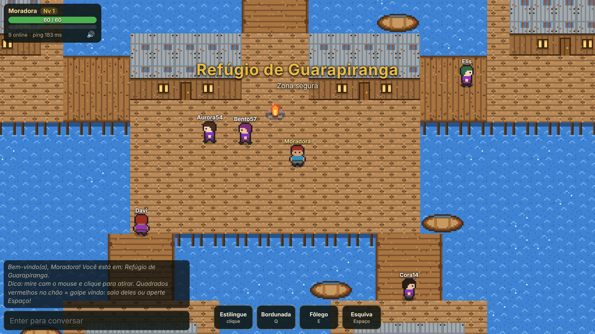
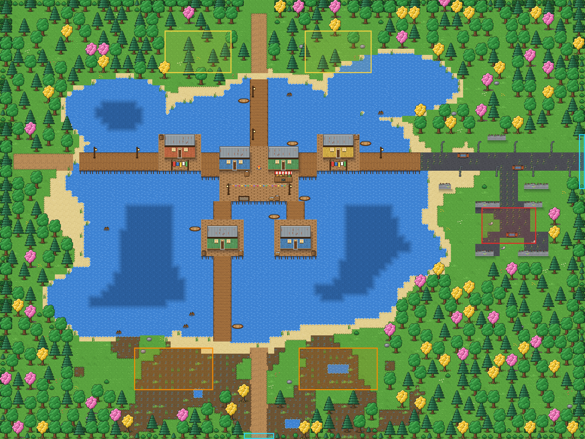
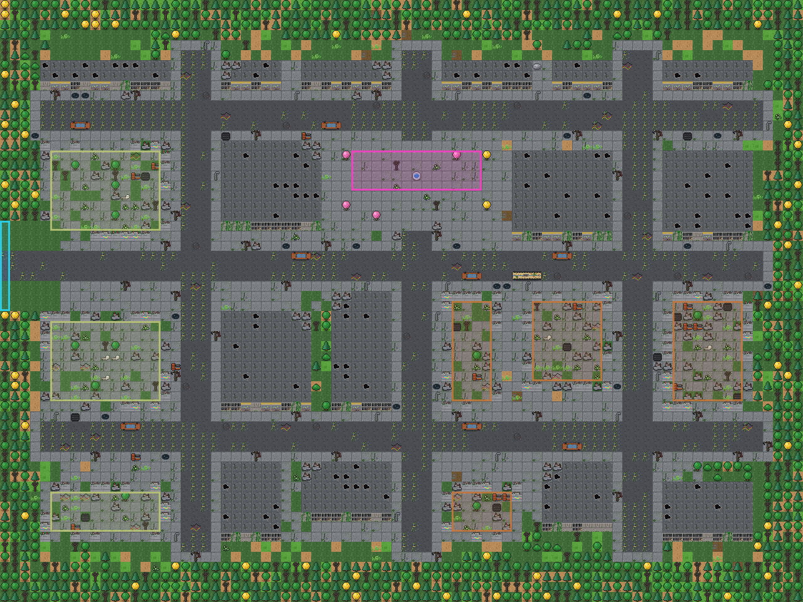
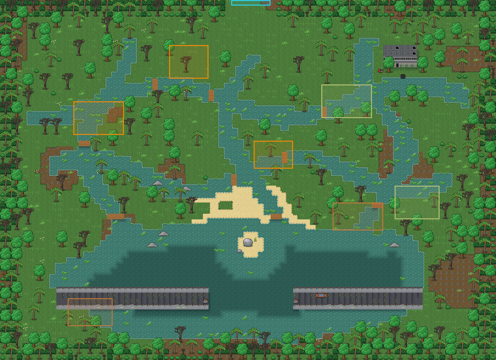

# MeuMMO

MMORPG de ação em 2D, inspirado no **folclore brasileiro**, que roda no navegador do computador e do celular.
Feito em dupla: ideias, design e testes de um lado, código do Claude do outro. O nome é provisório.

O mundo é **Pindorama — Selva de Pedra**: muito tempo depois do fim do mundo, a floresta tomou São Paulo e as
lendas voltaram. Tudo começa no **Refúgio de Guarapiranga**, uma vila flutuante no meio da represa.



## Onde estamos: M1 — Combate de ação ✅ · M2 — Progresso salvo ✅ · M3 — Mundo (começando)

- Entre com **nome e senha**: na primeira vez o personagem nasce na hora; depois ele volta com o nível,
  a XP, a vida, a mochila e o lugar onde parou
- Siga a avenida a leste até o fim e chegue nas **Ruínas de Santo Amaro** (níveis 4 a 8): quarteirões de prédios
  mortos e lojas fechadas. Nos prédios desabados vivem o **Corpo-Seco** e o **Capelobo**; no largo do chafariz seco,
  a chefe: a **Mula sem Cabeça**, que dá investidas em linha reta e deixa o chão pegando fogo
- Desça a trilha do brejo, ao sul, até a **Represa Billings**: um labirinto de canais de água verde e ilhas de
  mato ligadas por passarelas, com buritis, aguapés, casas afundadas, a usina velha, a ponte da rodovia quebrada
  no meio do lago e a prainha de frente para a pedra onde a **Iara** vai cantar (as criaturas de lá ainda estão
  chegando; por enquanto quem mora é Jararaca, Corpo-Seco e Capelobo)
- Explore o Refúgio de Guarapiranga com outros jogadores, em tempo real, com chat: píeres, matas, brejo e uma avenida em ruínas
- Enfrente o **Sagui Travesso** (joga frutas), a **Jararaca** (dá o bote) e o **Saci** (gira e some num redemoinho)
- Os monstros **avisam** os golpes com quadrados vermelhos no chão: saia de lá ou use a esquiva
- Ganhe XP, suba de nível e volte para a vila quando desmaiar
- Monstros deixam **itens** para quem ajudou a derrubá-los: guarde na **Mochila**, equipe chapéus, estilingues,
  coletes e amuletos (mais vida, dano e defesa) e coma bananas para recuperar vida
- O que você equipa **aparece no seu personagem** para todo mundo ver (e no boneco da mochila)
- Funciona no computador (mouse e teclado) e no celular (toque e botões)

### Controles

| Ação | Computador | Celular |
|---|---|---|
| Andar | `W` `A` `S` `D` / setas (duas juntas = diagonal, ex.: `W`+`D`), ou botão direito no chão | toque no chão |
| Estilingue | mire com o mouse e clique (segure para continuar) | toque no monstro ou segure **Estilingue** |
| Bordunada (golpe em arco) | `Q` | botão **Bordunada** |
| Fôlego (cura) | `E` | botão **Fôlego** |
| Esquiva | `Espaço` | botão **Esquiva** |
| Conversar | `Enter` | toque na caixa de conversa |
| Mochila (itens e equipamentos) | `I` ou o botão **Mochila** · clique duplo num item equipa/usa · `Esc` fecha | botão **Mochila** |
| Som ligado/desligado | `M` ou 🔊 no painel | 🔊 no painel |

A visão do jogo está em [docs/DESIGN.md](docs/DESIGN.md) e o que vem depois em [docs/ROADMAP.md](docs/ROADMAP.md).

## Instalar no Windows (jeito fácil)

Abra o **PowerShell** (tecla Windows, digite `PowerShell`, Enter), cole esta linha e aperte Enter:

```powershell
irm https://raw.githubusercontent.com/bru1dasul-create/meummo/main/instalar-windows.ps1 | iex
```

Ele instala o que faltar (Node.js e Git), baixa o jogo em `E:\mmorpg`, instala as dependências
e cria dois atalhos na área de trabalho: **Jogar MeuMMO** e **Atualizar MeuMMO**.
Também oferece instalar o Tiled (editor de mapas). Pode rodar de novo quando quiser: ele só atualiza
e nunca apaga uma pasta que já tenha outras coisas.

## Como jogar no seu computador (qualquer sistema)

Precisa do [Node.js](https://nodejs.org) versão 22.13 ou mais nova. No terminal, dentro da pasta do projeto:

```bash
npm install
```

```bash
npm run dev
```

Abra **http://localhost:5173**. Para jogar com alguém na mesma rede Wi-Fi (inclusive pelo celular),
use o endereço que aparece como `Network` no terminal, por exemplo `http://192.168.0.10:5173`.

Quer ver o mundo cheio? Com o jogo rodando, abra outro terminal. Bots que passeiam pela vila:

```bash
npm run bots -- 10
```

Bots que caçam monstros:

```bash
npm run bots -- 6 --cacar
```

## Comandos

| Comando | O que faz |
|---|---|
| `npm run dev` | jogo + servidor em modo de desenvolvimento (recarregam sozinhos ao salvar) |
| `npm run check` | confere os tipos e roda todos os testes automáticos |
| `npm run build` e depois `npm start` | versão de produção: um único servidor na porta 3000 (reinicie o `npm start` depois de cada build) |
| `npm run bots -- 10` | 10 jogadores automáticos andando e conversando (`--cacar` para caçarem monstros); aparecem como "Bot ..." |
| `npm run gen:tiles` | redesenha a arte provisória (`public/assets/tiles.png`) |
| `npm run render:map` | desenha os mapas inteiros em `docs/mapa-<id>.png` |

## Personagens salvos

Cada personagem (nome + senha + progresso) fica no arquivo `saves/meummo.db`, dentro da pasta do jogo
(no seu PC, `E:\mmorpg\saves`). Esse arquivo **não vai para o GitHub** e o **Atualizar MeuMMO não mexe nele**.

- O jogo salva sozinho: ao sair, ao subir de nível, a cada 30 segundos e quando o servidor desliga.
- **Cópia de segurança:** com o jogo fechado, copie a pasta `saves` para outro lugar.
- **Começar do zero:** com o jogo fechado, apague a pasta `saves`.
- As senhas não ficam escritas no arquivo: ficam embaralhadas (scrypt), e nem quem abre o arquivo consegue lê-las.
  Ainda assim, por enquanto use uma senha só do jogo: na rede de casa ela viaja sem criptografia
  (isso muda quando o jogo for para a internet, no M5).

## Ajustar os monstros (sem programar)

Cada monstro fica em [`data/monsters.json`](data/monsters.json): `vida`, `dano` ([mínimo, máximo]),
`passoMs` (tempo para andar um quadrado — menor é mais rápido), `alcanceAgressao`, `xp`, `renascerMs`
e o `ataque` (`tipo`: `mordida`, `bote`, `giro`, `projetil` ou `investida`; `preparoMs` é o tempo do aviso vermelho).
Na `investida`, o monstro corre `alcance` tiles em linha reta atropelando quem estiver no caminho; com
`"rastroFogo": { "duracaoMs": 2500, "dano": [4, 7] }` o caminho fica pegando fogo e queima quem fica em cima.
Salve e reinicie o servidor. Se algo estiver errado no arquivo, o servidor explica o quê.

O que cada monstro deixa fica na lista `itens` dele: `item` (o id em `data/items.json`), `chance` (em %, de 0 a 100)
e `quantidade` (opcional: um número, ou [mínimo, máximo]). Exemplo:
`"itens": [{ "item": "banana", "chance": 50, "quantidade": [1, 2] }]`. Cada um que ajudou sorteia os seus.

O ouro que cada monstro deixa fica no campo `ouro`: um número (ex.: `"ouro": 5`) ou [mínimo, máximo]
(ex.: `"ouro": [2, 6]`). Sem o campo, o monstro não deixa ouro. Como os itens, cada um que ajudou ganha o seu —
mas o ouro **cai no chão** onde o monstro estava: cada um vê só o seu montinho e pega chegando perto (some em
1 minuto, piscando antes). Item que não cabe na mochila também fica no chão, por 2 minutos.

## Criar e ajustar itens (sem programar)

Os itens ficam em [`data/items.json`](data/items.json). O nome de cada bloco é o **id** do item (sem acento e sem
espaço, ex.: `chapeu_palha`); é ele que os monstros usam na lista `itens`.

| Campo | O que é |
|---|---|
| `nome` | o nome que aparece no jogo |
| `preco` | quanto custa na loja, em ouro (a loja paga uma parte disso quando você vende; sem `preco`, não se compra nem se vende) |
| `tipo` | `equipamento`, `consumivel` (de comer/usar) ou `material` (para trocas e missões, no futuro) |
| `parte` | só equipamento: `arma`, `cabeca`, `corpo` ou `amuleto` |
| `dano`, `vida`, `defesa` | só equipamento: quanto soma ao personagem (defesa tira isso de cada golpe, mas sempre sobra 1) |
| `cura`, `recargaMs` | só consumível: quanto de vida recupera e quanto tempo esperar até o próximo (padrão 3000) |
| `pilha` | quantos cabem num espaço da mochila (padrão 20; equipamento é sempre 1) |
| `raridade` | `comum`, `raro` (borda azul) ou `lendario` (dourado; todo mundo fica sabendo quando alguém pega) |
| `descricao` | o textinho do item |
| `icone` | o desenho: `banana`, `couro`, `chapeu_palha`, `estilingue`, `colar`, `gibao`, `gorro`, `erva`, `sucata`, `faca`, `couraca`, `ferradura` ou `mochila` |

O equipamento também aparece no personagem, pelo ícone: `chapeu_palha` e `gorro` (cabeça), `gibao` e `couraca`
(corpo), `estilingue` e `faca` (arma), `colar` e `ferradura` (amuleto). Desenho novo para um ícone ou para uma peça
no corpo precisa de código (`src/client/itemArt.ts` e `src/client/game/characters.ts`) — é só pedir; o
`npm run check` avisa se algum equipamento ficou sem desenho no personagem. Se um item for apagado do
arquivo, ele some das mochilas na próxima vez que cada um entrar (o servidor avisa no terminal).

## Vendedores e loja (sem programar)

Os personagens que não são jogadores (como a **Dona Iracema**, quitandeira do píer, no Refúgio) ficam em
[`data/npcs.json`](data/npcs.json). Clicando (ou tocando) nela, o personagem anda até perto e abre a loja.

| Campo | O que é |
|---|---|
| `nome`, `titulo` | o nome e o que ela é (aparece embaixo do nome) |
| `mapa`, `x`, `y` | em que mapa fica (nome do arquivo em `public/assets/maps`, sem `.tmj`) e em que tile — a posição que o Tiled mostra |
| `fala` | o que ela diz quando você chega para negociar |
| `veste` | itens que aparecem nela, como o equipamento dos jogadores (ex.: `["chapeu_palha"]`) |
| `loja.vende` | ids dos itens que ela vende (pelo `preco` de cada um em `data/items.json`) |
| `loja.compraPor` | quanto ela paga pelo que você vende, em % do preço (50 = metade) |

Para mudar preços, mexa no `preco` de cada item; para mudar o que ela vende, na lista `vende`. Salve e reinicie
o servidor. Se o lugar dela ficar bloqueado (o mapa mudou), ela vai para o chão livre mais perto e o servidor avisa.

## Editar os mapas

Os mapas são feitos no [Tiled](https://www.mapeditor.org/), um editor gratuito. Cada zona é um arquivo em
`public/assets/maps`, e o nome do arquivo é o **id** do mapa: `refugio.tmj` (Refúgio de Guarapiranga, onde
todo mundo começa), `santo-amaro.tmj` (Ruínas de Santo Amaro) e `billings.tmj` (Represa Billings). Em cada mapa:

- camadas de tiles, de baixo para cima: `ground` (o chão), `sombras` (sombra de casas e prédios), `decor`
  (troncos, casas, flores…) e `acima`, que o jogo desenha **por cima dos personagens**: copa das árvores e alto
  dos postes. Quem passa embaixo some atrás das folhas (a copa fica transparente para dar para ver). Nada que
  bloqueia vai na `acima` — o que bloqueia é o tronco, na `decor`
- as árvores grandes têm 2 tiles de largura e 3 de altura: os 4 de cima (`..._tl`, `_tr`, `_ml`, `_mr`) na
  camada `acima` e os 2 do tronco (`..._bl`, `_br`) na `decor`; postes altos: `..._top` na `acima`, `..._base`
  na `decor`
- propriedade `colide` nos tiles: bloqueia a passagem; `bloqueiaTiro`: segura projéteis (a água não segura)
- propriedades `luz` (uma cor, ex.: `#ffb04a`) e `luzRaio` (tamanho em pixels) num tile: ele brilha no jogo
  (a fogueira, as lamparinas e as janelas acesas). Tiles animados (água, fogueira) usam a animação do Tiled
- propriedade `faiscas` num tile: solta faíscas subindo (as brasas e o tambor com fogo de Santo Amaro)
- propriedades do mapa `neblina` e `escuro` (de 0 a 1): neblina passando por cima de tudo e o lugar mais escuro
  (Santo Amaro usa 0.22 e 0.14; o Refúgio não usa); `vagalumes` (0 a 1): vaga-lumes piscando (a Billings usa 0.7)
- camada de objetos `lendas` (na Billings): áreas marcadas para criaturas que ainda vão existir (`iara`, `boto`,
  `jacare`). O servidor ignora; quando a criatura existir, a área passa para a camada `monstros`
- beiradas entre terrenos (areia e água, grama e terra...) são tiles próprios, como `shore_3` (água ao norte e a
  leste) ou `sand_grass_c_ne` (grama só no canto de cima à direita): o número diz os lados que encostam no
  outro terreno (1 = norte, 2 = leste, 4 = sul, 8 = oeste, somados). Os geradores escolhem sozinhos
- o ponto `spawn`, na camada `objects`, é onde os jogadores nascem
- camada `monstros`: cada retângulo é uma área de monstros; o nome é o monstro (ex.: `jararaca`) e a
  propriedade `quantidade` diz quantos
- camada `saidas`: cada retângulo leva para outro mapa. Propriedade `mapa` = id do mapa de destino
  (ex.: `santo-amaro`) e `chegada` = nome do ponto onde você aparece lá (ex.: `oeste`). O nome do retângulo
  vira a placa que aparece no jogo (ex.: "Ruínas de Santo Amaro")
- pontos com nome (ex.: `oeste`, `leste`) na camada `objects` são lugares de chegada — não deixe um ponto de
  chegada em cima de uma saída, senão a pessoa volta na hora (o servidor avisa)
- propriedades do mapa (no Tiled: Map > Map Properties): `nome` é o nome da zona que aparece ao entrar,
  `seguro` marca zona segura, `inicial` marca onde os personagens novos começam e `renascerEm` diz em que
  mapa acorda quem desmaia ali (Santo Amaro não tem vila: quem desmaia lá acorda no Refúgio)

Para criar uma zona nova: faça o mapa no Tiled (pode copiar um existente), salve em `public/assets/maps`
e coloque saídas ligando os dois lados. Depois de salvar, reinicie o servidor e recarregue o jogo.
Se uma saída apontar para um mapa ou ponto que não existe, o servidor explica o erro ao ligar.







Nos mapas: **amarelo** = Sagui Travesso, **laranja** = Jararaca, **vermelho** = Saci, **azul-claro** = saída
para outro mapa.

## Organização

| Pasta | O que tem |
|---|---|
| `src/shared` | regras usadas pelo jogo e pelo servidor (movimento, combate, mapa, mensagens) |
| `src/server` | o servidor (Node.js + WebSocket): quem manda no mundo, nos monstros e no combate |
| `src/client` | o jogo no navegador (Phaser) |
| `data` | números dos monstros |
| `public/assets` | arte e mapas |
| `scripts` | gerador de arte, gerador de mapa e bots |
| `tests` | testes automáticos |
| `docs` | design, roteiro e explicação de como tudo funciona ([ARQUITETURA.md](docs/ARQUITETURA.md)) |
