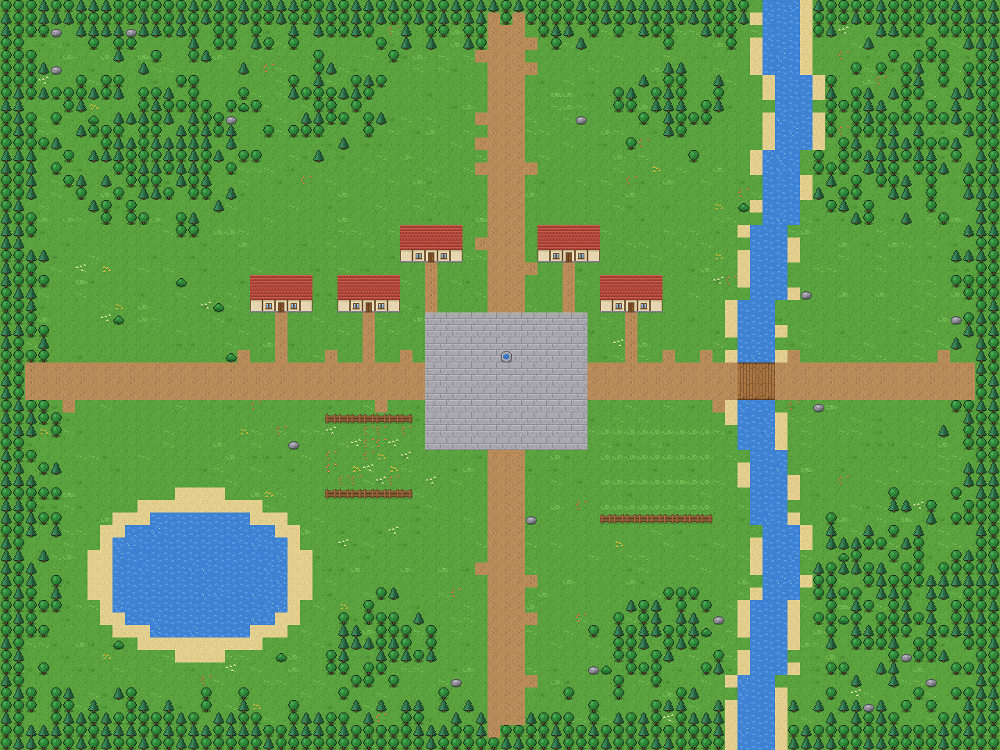

# MeuMMO

MMORPG de ação em 2D, inspirado no **folclore brasileiro**, que roda no navegador do computador e do celular.
Feito em dupla: ideias, design e testes de um lado, código do Claude do outro. O nome é provisório.


## Onde estamos: M1 — Combate de ação ✅

- Explore a vila e os arredores com outros jogadores, em tempo real, com chat
- Enfrente o **Sagui Travesso** (joga frutas), a **Jararaca** (dá o bote) e o **Saci** (gira e some num redemoinho)
- Os monstros **avisam** os golpes com quadrados vermelhos no chão: saia de lá ou use a esquiva
- Ganhe XP, suba de nível e volte para a vila quando desmaiar
- Funciona no computador (mouse e teclado) e no celular (toque e botões)

### Controles

| Ação | Computador | Celular |
|---|---|---|
| Andar | `W` `A` `S` `D` / setas (duas juntas = diagonal, ex.: `W`+`D`), ou botão direito no chão | toque no chão |
| Estilingue | mire com o mouse e clique (segure para continuar) | toque no monstro ou segure **Estilingue** |
| Bordunada (golpe em arco) | `Q` | botão **Bordunada** |
| Fôlego (cura) | `E` | botão **Fôlego** |
| Esquiva | `Espaço` | botão **Esquiva** |
| Conversar | `Enter` | toque na caixa de conversa |
| Som ligado/desligado | `M` ou 🔊 no painel | 🔊 no painel |

A visão do jogo está em [docs/DESIGN.md](docs/DESIGN.md) e o que vem depois em [docs/ROADMAP.md](docs/ROADMAP.md).

## Instalar no Windows (jeito fácil)

Abra o **PowerShell** (tecla Windows, digite `PowerShell`, Enter), cole esta linha e aperte Enter:

```powershell
irm https://raw.githubusercontent.com/bru1dasul-create/meummo/main/instalar-windows.ps1 | iex
```

Ele instala o que faltar (Node.js e Git), baixa o jogo em `E:\mmorpg`, instala as dependências
e cria dois atalhos na área de trabalho: **Jogar MeuMMO** e **Atualizar MeuMMO**.
Também oferece instalar o Tiled (editor de mapas). Pode rodar de novo quando quiser: ele só atualiza
e nunca apaga uma pasta que já tenha outras coisas.

## Como jogar no seu computador (qualquer sistema)

Precisa do [Node.js](https://nodejs.org) versão 22 ou mais nova. No terminal, dentro da pasta do projeto:

```bash
npm install
```

```bash
npm run dev
```

Abra **http://localhost:5173**. Para jogar com alguém na mesma rede Wi-Fi (inclusive pelo celular),
use o endereço que aparece como `Network` no terminal, por exemplo `http://192.168.0.10:5173`.

Quer ver o mundo cheio? Com o jogo rodando, abra outro terminal. Bots que passeiam pela vila:

```bash
npm run bots -- 10
```

Bots que caçam monstros:

```bash
npm run bots -- 6 --cacar
```

## Comandos

| Comando | O que faz |
|---|---|
| `npm run dev` | jogo + servidor em modo de desenvolvimento (recarregam sozinhos ao salvar) |
| `npm run check` | confere os tipos e roda todos os testes automáticos |
| `npm run build` e depois `npm start` | versão de produção: um único servidor na porta 3000 (reinicie o `npm start` depois de cada build) |
| `npm run bots -- 10` | 10 jogadores automáticos andando e conversando (`--cacar` para caçarem monstros) |
| `npm run gen:tiles` | redesenha a arte provisória (`public/assets/tiles.png`) |
| `npm run render:map` | desenha o mapa inteiro em `docs/mapa.png` |

## Ajustar os monstros (sem programar)

Cada monstro fica em [`data/monsters.json`](data/monsters.json): `vida`, `dano` ([mínimo, máximo]),
`passoMs` (tempo para andar um quadrado — menor é mais rápido), `alcanceAgressao`, `xp`, `renascerMs`
e o `ataque` (`tipo`: `mordida`, `bote`, `giro` ou `projetil`; `preparoMs` é o tempo do aviso vermelho).
Salve e reinicie o servidor. Se algo estiver errado no arquivo, o servidor explica o quê.

## Editar o mapa

O mapa é feito no [Tiled](https://www.mapeditor.org/), um editor gratuito. Abra `public/assets/maps/world.tmj`:

- camada `ground`: o chão; camada `decor`: árvores, casas, flores…
- propriedade `colide` nos tiles: bloqueia a passagem; `bloqueiaTiro`: segura projéteis (a água não segura)
- o ponto `spawn`, na camada `objects`, é onde os jogadores nascem
- camada `monstros`: cada retângulo é uma área de monstros; o nome é o monstro (ex.: `jararaca`) e a
  propriedade `quantidade` diz quantos

Depois de salvar, reinicie o servidor e recarregue o jogo.



Áreas de monstros no mapa: **amarelo** = Sagui Travesso, **laranja** = Jararaca, **vermelho** = Saci.

## Organização

| Pasta | O que tem |
|---|---|
| `src/shared` | regras usadas pelo jogo e pelo servidor (movimento, combate, mapa, mensagens) |
| `src/server` | o servidor (Node.js + WebSocket): quem manda no mundo, nos monstros e no combate |
| `src/client` | o jogo no navegador (Phaser) |
| `data` | números dos monstros |
| `public/assets` | arte e mapas |
| `scripts` | gerador de arte, gerador de mapa e bots |
| `tests` | testes automáticos |
| `docs` | design, roteiro e explicação de como tudo funciona ([ARQUITETURA.md](docs/ARQUITETURA.md)) |
